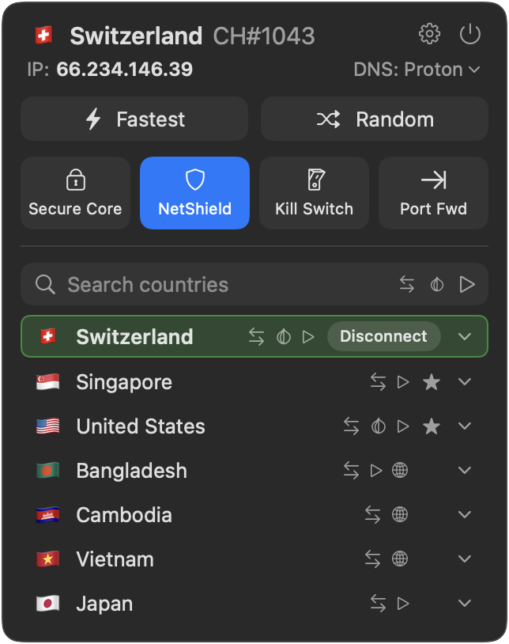

# Proton VPN Menu Bar

[](https://github.com/stevelacey/proton-vpn-menubar/releases)
[](https://github.com/stevelacey/proton-vpn-menubar/actions/workflows/ci.yml?query=branch:main)
[](https://codecov.io/gh/stevelacey/proton-vpn-menubar)
[](https://github.com/stevelacey/proton-vpn-menubar/releases)
[](#install)
[](LICENSE)

A small menu bar app for Proton VPN on macOS, built on the
[Proton VPN CLI for macOS](https://github.com/stevelacey/proton-vpn-cli-macos).




> [!NOTE]
> Unofficial, not affiliated with Proton.

## Related projects

- **[Proton VPN CLI for macOS](https://github.com/stevelacey/proton-vpn-cli-macos)**: `protonvpn` in your terminal
- **[Alfred Proton VPN](https://github.com/stevelacey/alfred-proton-vpn)**: `vpn swiss` from Alfred

They share the same connection. Don't run Proton's Mac app at the same time, since it has its own
connection that these can't see.

## Features

- ⚡ Fastest and random servers, recent countries and pinned favorites
- 🔎 Country search with P2P, Tor and streaming filters
- 🗺️ Cities and servers, with their load
- 🔒 Secure Core, NetShield, kill switch and port forwarding
- 🌐 Proton, Cloudflare, Google, OpenDNS or Quad9 DNS
- ⌨️ Keyboard shortcuts (hold ⌘) and global hotkeys

## Install

```sh
brew install stevelacey/tap/proton-vpn-cli stevelacey/tap/proton-vpn-menubar
```

The app asks once for your Mac's password to set up the
[CLI](https://github.com/stevelacey/proton-vpn-cli-macos), so connecting doesn't need it again.

Or download the app from [releases](https://github.com/stevelacey/proton-vpn-menubar/releases).

Requires macOS 14 or later.

## Development

```sh
swift test   # runs the tests
./build      # builds .build/Proton VPN Menu Bar.app
./install    # installs it to ~/Applications and opens it
```

## License

GPLv3
