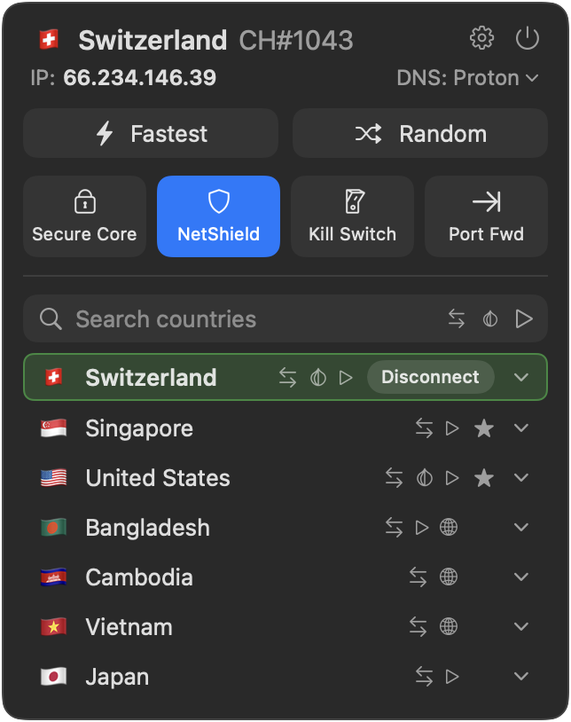

# Proton VPN Menu Bar

[](https://github.com/stevelacey/proton-vpn-menubar/releases)
[](https://github.com/stevelacey/proton-vpn-menubar/actions/workflows/ci.yml?query=branch:main)
[](https://codecov.io/gh/stevelacey/proton-vpn-menubar)
[](https://github.com/stevelacey/proton-vpn-menubar/releases)
[](LICENSE)

A small menu bar app for Proton VPN on macOS, built on the
[Proton VPN CLI for macOS](https://github.com/stevelacey/proton-vpn-cli-macos). It does
what you need from the menu bar and nothing else: no windows, no dock icon.




> [!NOTE]
> Unofficial: made by a fan of Proton VPN, not by or with Proton AG.

## Better together

- **[Proton VPN CLI for macOS](https://github.com/stevelacey/proton-vpn-cli-macos)**: `protonvpn` in your terminal
- **[Alfred Proton VPN](https://github.com/stevelacey/alfred-proton-vpn)**: `vpn swiss` from Alfred

They all drive the same connection: connect from one and the others keep up. Use them instead of
Proton's Mac app, not alongside it, since it runs its own VPN connection that these can't see or control.

## Features

- ⚡ Fastest and random servers, recent countries and pinned favorites
- 🔎 Country search, with P2P, Tor and streaming filters
- 🗺️ Cities and servers with their load, to pick one yourself
- 🔒 Secure Core, NetShield, kill switch and port forwarding
- 🌐 DNS: Proton's, Cloudflare, Google, OpenDNS or Quad9
- 🔄 Updates instantly when you connect from the CLI or Alfred
- 🚀 Opens at login and can reconnect on launch

## Install

```sh
brew install stevelacey/tap/proton-vpn-cli
brew install --cask stevelacey/tap/proton-vpn-menubar
```

The app asks once for your Mac's password to set up the
[CLI](https://github.com/stevelacey/proton-vpn-cli-macos), so connecting doesn't need it again.

Or download the app from [releases](https://github.com/stevelacey/proton-vpn-menubar/releases).

Requires macOS 14 or later.

## Development

```sh
swift test   # runs the tests
./build      # builds .build/Proton VPN Menu Bar.app
./install    # installs it to ~/Applications and opens it
```

## License

GPLv3
